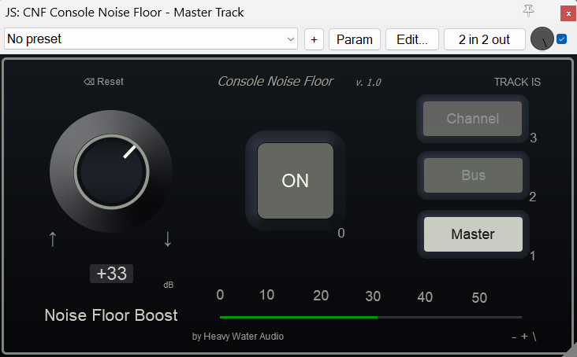
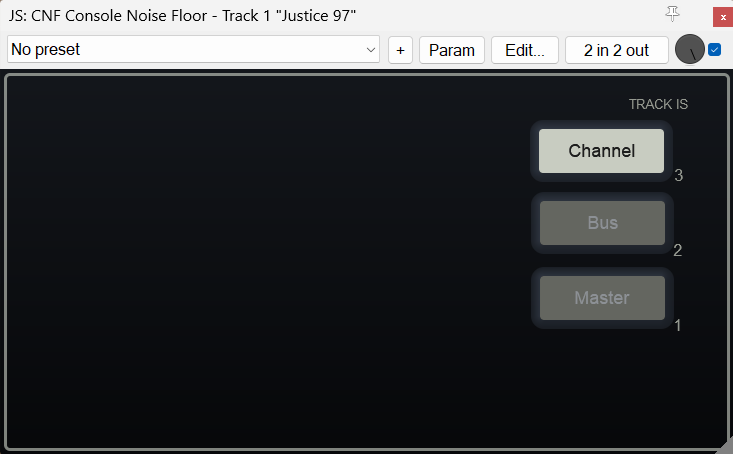
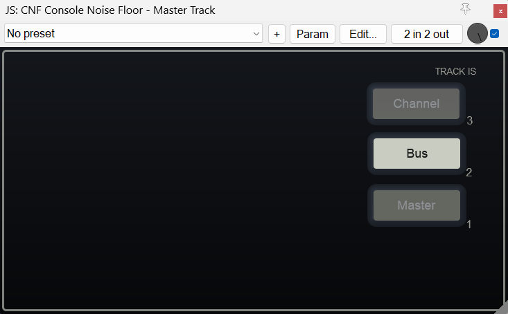
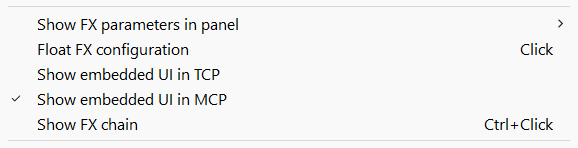
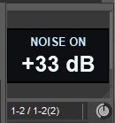
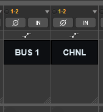

# CNF Console Noise Floor

**A free [JSFX](https://www.reaper.fm/sdk/js/) plugin for REAPER: the quiet hiss of an analog mixing console. By Heavy Water Audio.**
**GUI made in [Facelift](https://github.com/heavywateraudio/facelift-jsfx).**

A real console is never silent. Every channel, bus and output amp adds a little noise.
That noise is part of why a console mix feels full and alive.
CNF puts that noise floor back into your mix.
It is very quiet: felt, not heard.
It grows the way a real console does: the more tracks you use, the higher the floor.



*CNF on the master track, in the Master role.*

## How it works

### One plugin, three roles

You put CNF on each track. Each one plays one role:

1. **Channel:** the noise of one console channel. Put it on each track.
2. **Bus:** the noise of a summing bus. Put it on a bus or folder track.
3. **Master:** the noise of the master section. Put it on the master track.

They all talk to each other inside REAPER.
They share settings only. They never send audio to each other.

### The Master is the boss

1. Only one CNF can be the Master. A second one that asks for Master goes back to its old role.
2. Channels and Buses follow the Master.
3. With no Master in the project, every Channel and Bus is silent.
4. The Master's On/Off switch turns the noise on or off in the Master and in every Channel and Bus at once.
5. The Master's Noise Floor Boost raises the noise in the Master and in every Channel and Bus at once.
6. If the Master is removed, the others go silent within one second.

### The noise itself

1. Each CNF makes its own noise, so no two sound the same.
2. Left and right are separate noises, so the noise is stereo, not mono.
3. The noise is 70% pink and 30% white. Pink is warm and soft; white adds a little air.
4. A filter takes out rumble below about 48 Hz and harsh hiss above about 11 kHz.
5. On load, CNF measures its own noise and sets it to an exact level.

### How loud each role is

| Role    | Level            | Sound                                                                                       |
| ------- | ---------------- | ------------------------------------------------------------------------------------------- |
| Channel | -109 dBFS        | Pink and white, 48 Hz to 11 kHz.                                                            |
| Bus     | -108 dBFS        | Warmer: more pink, less top (55 Hz to 10.5 kHz).                                            |
| Master  | -108 dBFS and up | Same tone as Channel. Starts at -108 dBFS with no Channels, then rises as you add Channels. |

For scale: the dither noise of a 16-bit file sits near -96 dBFS. One Channel is far below that. A big mix gets close to it, like a real desk.

### More tracks, more noise

On a real console, every open channel adds a little hiss to the mix.
So a 60-track mix has a higher noise floor than a 10-track mix.
CNF works the same way.

#### Where the noise comes from

The noise you hear is three kinds added together:

1. **Channel noise.** Each Channel adds its own hiss, at -109 dBFS.
2. **Bus noise.** Each Bus adds its own hiss, at -108 dBFS.
3. **Master noise.** The Master plays the console's main mix section. Its hiss has two parts:
   - **A fixed part.** On a real console, the mix passes through two amplifiers before it leaves the desk: the mix amp, which adds all channels together, and the output amp, which sends the mix out. Both hiss a little, always by the same amount. CNF puts them at -112 and -110 dBFS, about -108 dBFS together.
   - **A growing part.** The Master counts the Channels and adds a little more hiss for each one. It is about 15 dB quieter than the Channels' own noise, so it only adds a touch.

Buses are not counted by the Master. A Bus adds only its own hiss.

The more Channels you already have, the less each new one adds.
Going from 1 to 2 Channels adds 3 dB. Going from 32 to 64 also adds only 3 dB.

#### How loud it gets

All Channels with faders at 0 dB, no Buses, Noise Floor Boost at 0 dB:

| Channels | Total noise |
| -------- | ----------- |
| 1        | -105 dBFS   |
| 8        | -99 dBFS    |
| 16       | -97 dBFS    |
| 32       | -94 dBFS    |
| 64       | -91 dBFS    |

Each Bus adds a little more on top.
Lower faders mean less noise from those tracks, like on a real desk.

### What the Bus role adds

A summing bus sounds different from a channel. So the Bus role is not just louder Channel noise:

1. It is warmer and darker: more pink, less top.
2. Part of its noise is the same on left and right, like the shared electronics of a bus. The rest stays separate, so the image stays wide.
3. It breathes a tiny bit with the music: when the bus gets busy, its noise rises by up to 0.5 dB, over about one second. It never pumps.
4. A 9th Bus shows `BUS FULL` and stays silent. To retry, select Channel, then Bus again.

### Smooth changes

1. Turning the noise on or off fades over about 150 ms. No clicks.
2. Moving the boost glides over about 50 ms. No zipper noise.
3. The noise also plays when REAPER is stopped, like a console that is switched on.

### Light on CPU

CNF is built to sit on every track of a big project.

1. The sound part is small: a few random numbers and simple filters for each sample. No oversampling, no FFT.
2. No latency: CNF adds no delay to your tracks.
3. When the noise is off, CNF fades out, then stops making noise. It does almost no work until you turn it back on.
4. Heavier jobs, like finding the Master and counting the Channels, run once per audio block, not once per sample.
5. The GUI only draws while its window or its mixer view is open.
6. CNF went through two rounds of CPU tuning. Both kept the sound the same.

### Limits

1. Up to 180 Channels per project.
2. Up to 8 Buses per project.
3. One Master per project.

## Controls

### Master

| Control                    | What it does                                              |
| -------------------------- | --------------------------------------------------------- |
| **Noise Floor Boost**      | Raises the noise above the real console level, 0 to 50 dB. |
| **ON / OFF**               | Turns the noise on or off in every CNF in the project.    |
| **Channel / Bus / Master** | Picks the role of this CNF.                               |

0 dB is the calibrated console floor. Leave it there for normal mixing.
Raise the boost to hear what the noise adds, or when you want a louder noise layer on purpose.

### Channel and Bus



*A Channel: only the role buttons. It follows the Master.*




*A Bus.*

Channel and Bus show only the role buttons.
Their noise, On/Off and boost come from the Master.

## Keyboard keys

| Key         | What it does                     |
| ----------- | -------------------------------- |
| `↑` `↓`     | Noise Floor Boost (Master)       |
| `Backspace` | Resets Noise Floor Boost to 0 dB |
| `0`         | Noise ON / OFF (Master)          |
| `1`         | Master                           |
| `2`         | Bus                              |
| `3`         | Channel                          |
| `-` `+` `\` | Scale the plugin window          |

## Any size

The GUI is drawn with vector shapes, not pictures.
So you can scale it up to fill the whole screen, and it stays sharp.

## In the mixer

CNF also draws a small view inside REAPER's mixer (MCP) and track panel (TCP).

To turn it on:

1. Right-click CNF in the track's FX inserts.
2. Click **Show embedded UI in MCP**, or **Show embedded UI in TCP**.



*The FX insert menu in REAPER.*



*The Master in the mixer.*



*A Bus and a Channel in the mixer.*

1. Channel shows `CHNL`. Bus shows `BUS <n>`, or `FULL BUS` when no slot is free.
2. The Master shows `NOISE ON` or `NOISE OFF` and the boost in dB.
3. On the Master, click `NOISE` to turn the noise on or off.
4. On the Master, drag the dB number up or down to change the boost.
5. On the Master, click the black space near `NOISE` to open the plugin window.

## Where to put it

1. **Each track:** CNF in the Channel role, first in the FX chain.
2. **Each bus or folder track:** CNF in the Bus role, first in the FX chain. That's where a real bus adds its noise: as the tracks are summed, before any bus effects.
3. **Master track:** CNF in the Master role, before your final limiter.

### With TAMD and THS

I first built CNF as a partner for two plugins by Doc Shadrach:
[The Analog Molecule Deluxe (TAMD)](https://ko-fi.com/s/e46fdb9a07) and [The Hot Summer (THS)](https://ko-fi.com/s/ca45a753b6).
TAMD has no noise floor of its own, so CNF adds one.

With TAMD and THS, use this order:

```
Each track:     CNF (Channel) -> TAMD Channel -> REAPER routing
Each bus track: CNF (Bus) -> TAMD Bus -> THS Stem Sender -> REAPER routing to its stem
Master track:   THS Master Summer -> TAMD Master -> CNF (Master) -> limiter
```

On tracks and bus tracks, CNF goes first, so its hiss passes through the console color.

On the master track, CNF goes after THS Master Summer, never before it.
THS Master Summer throws away channels 1 and 2 and replaces them with the sum of the stems, so a CNF placed before it would be lost.

## Download

**[Download CNF_Facelift.jsfx](https://github.com/heavywateraudio/cnf-jsfx/releases/download/cnf-facelift-v1.0/CNF_Facelift.jsfx)**

It's one file with everything inside.
[View the code](https://github.com/heavywateraudio/cnf-jsfx/blob/master/jsfx/CNF_Facelift.jsfx) on GitHub.

## Install

1. In REAPER, open **Options > Show REAPER resource path**.
2. Open the `Effects` folder.
3. Copy `CNF_Facelift.jsfx` into it.
4. In REAPER, open the FX window, click **Options**, then **Rescan all plug-ins**.
5. Search for `CNF Console Noise Floor` and add it to your tracks.
6. On the master track, set CNF to **Master**.

## Credits

- DSP: Andy Rx (Heavy Water Audio), v0.1.06, MIT License.
- GUI: Andy Rx (Heavy Water Audio), v1.0, MIT License.
- GUI made with [Facelift](https://github.com/heavywateraudio/facelift-jsfx).
